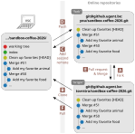
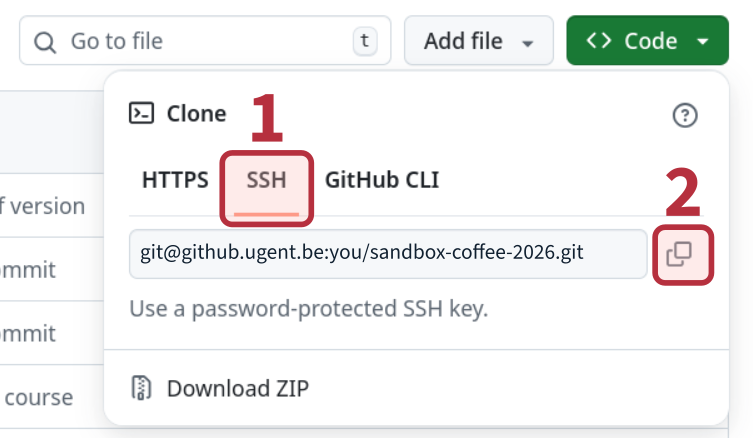

<!--
SPDX-FileCopyrightText: 2026 Toon Verstraelen <Toon.Verstraelen@UGent.be>
SPDX-License-Identifier: CC-BY-4.0
-->

<!-- This file is rendered from a template in handson/.template/. Edit the template instead. -->

# Working with Git in the terminal

> **Before you start**
>
> - You can log in to <https://github.ugent.be> with your UGent account.
> - You have a terminal to work in, see [Where to work](#where-to-work) below.
> - You have gone through [`handson_web.md`](handson_web.md).
>   In particular, you need a **fork** of the sandbox <https://github.ugent.be/tovrstra/sandbox-coffee-2026> under your own account.
>   If you do not have one yet, open the sandbox in your browser, click **Fork** and continue here.

## Overview

The goal of this guide is to replicate the workflow of [`handson_web.md`](handson_web.md)
using a terminal-based Git client, instead of the web interface of GitHub.
Some familiarity with virtual terminals and the [`nano`](https://www.nano-editor.org/) editor is assumed.

The guide has three parts:

1. **Set-up** (needed once per computer or account):
   [Where to work](#where-to-work), [Configure Git](#configure-git) and [Configure SSH](#configure-ssh).
1. **Hands-on exercise:**
   [Explain why you like an animal in `animals.md`](#explain-why-you-like-an-animal-in-animalsmd).
   This is the core of the tutorial, which you can start as soon as the set-up is done.
1. **Reference material** to read afterwards, or whenever you need it:
   [Most important Git commands](#most-important-git-commands),
   [Surviving Git in the terminal](#surviving-git-in-the-terminal) and the [Epilogue](#epilogue).

## Where to work

You need a virtual terminal running `bash` or `zsh`, with a recent version of Git, an SSH client and a text editor such as `nano`.
There are two ways to get this:

- **On your own laptop**, if you use Linux, macOS or Windows with WSL (Windows Subsystem for Linux).
  Git, SSH and `nano` are available there or can be installed with your package manager.
  The instructions below use `$VSC_DATA` as the directory in which you keep your repositories.
  On your own computer, replace it by any directory of your choice, e.g. `~/` or `~/projects/`.

- **On the VSC cluster (Donphan)**, which is recommended if:

  - you do not have a POSIX terminal on your computer, e.g. you use Windows without WSL, or
  - you want to practice Git specifically in this environment, e.g. because you will use it for your calculations on the cluster.

  Everything is already installed on the VSC, so you can follow the instructions below as they are written.

### Virtual terminal on VSC

Skip this section if you work on your own laptop.

Take the following steps to open a virtual terminal on the VSC cluster.

1. Go to [login.hpc.ugent.be](https://login.hpc.ugent.be)
   and click `Interactive Apps` -> `Shell (tmux)` in the blue bar.

1. Select the Donphan cluster from the list of clusters and request 2 hours.
   Other settings can be left to their defaults.
   Finally, scroll down and click the blue `Launch` button.

1. A job is started on Donphan for your tmux shell.
   After a minute, you should be able to click the blue `Connect` button to open the shell.

Now your virtual terminal is ready for the instructions below.

Note that copying and pasting in tmux are a bit different:

- **Select and copy** to clipboard

  - Line: `[Shift] + [LeftClick & Drag]`
  - Block: `[Shift] + [Alt] + [LeftClick & Drag]`

- **Paste** from the clipboard

  - `[Shift] + [Insert]`
  - `[Ctrl] + [Shift] + V`

## Configure Git

(This concerns local settings on your own computer or VSC account.)

When you locally commit modifications to a Git repository, some metadata is also recorded, such as the author and the time of the commit.
To make sure the author is set correctly, configure Git with the following commands:

```bash
git config --global user.name "Your Name"
git config --global user.email Your.Name@UGent.be
```

Where you make the following changes:

- Replace `"Your Name"` by your actual name, such as `Toon Verstraelen`.
- Replace `Your.Name@UGent.be` by your UGent e-mail.

The following settings are also recommended:

```bash
git config --global init.defaultBranch main
git config --global core.editor nano
git config --global pull.rebase true
```

It is more common these days to use `main` as the default branch name instead of `master`, which is the historical default.
The rebase setting is recommended to avoid unnecessary merge commits when pulling changes from the server.

## Configure SSH

Your local Git client can communicate with GitHub (and other online repositories) using the so-called [secure-shell](https://en.wikipedia.org/wiki/Secure_Shell) protocol, or SSH.
For this to work, you need to configure SSH on your computer.

### Create a key pair (and understand what that means)

When connecting to a remote server, it needs to verify your identity (called authentication), which is done through a so-called SSH key pair.
An SSH key pair consists of a public and a private key.
The public key may be shared with any server interested in authenticating your connections.
When you make a connection, the authentication is only possible when you possess the corresponding private key.
For sensitive work, the private key is usually stored in encrypted form on your laptop, which we'll skip here for convenience.

In a terminal window, a key pair is generated by the following command.

```bash
ssh-keygen -f ~/.ssh/id_github_ugent_be
```

When `ssh-keygen` asks something, just press `[Enter]` without filling in anything.

You will see something like this:

> ```
> Generating public/private rsa key pair.
> Enter passphrase (empty for no passphrase):
> Enter same passphrase again:
> Your identification has been saved in .../.ssh/id_github_ugent_be
> Your public key has been saved in .../.ssh/id_github_ugent_be.pub
> The key fingerprint is:
> SHA256:pFxrv91Ql70JwiZM5to2wzQ6zLNKFB8tpgHwBhV0KFU vsc40019@gligar11.gastly.os
> The key's randomart image is:
> +---[RSA 3072]----+
> | o=*+E           |
> | .o.o   .        |
> |  .o o +o+       |
> |  .  .*+B..     o|
> |     oo.S* + ...o|
> |    . o.*.+ ....o|
> |     . B *. .  o |
> |    .   = oo o   |
> |     ...  . . .  |
> +----[SHA256]-----+
> ```

The result is a non-encrypted private key, stored in the default location.

The reason we don't recommend a passphrase is that it only provides limited additional security in exchange for considerable inconvenience.
Key encryption mainly adds an extra layer of protection in case somebody gains access to your computer.
This may happen by old-fashioned theft of your hardware, yet spyware is more common.
When this happens, key encryption offers limited protection, e.g. spyware can also easily steal your passphrase through key-logging.
Even old-fashioned thieves have [cheap and effective means of recovering your password](https://xkcd.com/538/).

If you care about security, the following are more effective: use up-to-date and legal software, block advertisements, and don't open questionable e-mails, attachments or web pages.
If someone or something gives you the impression you need to act **NOW (!!!)**, it is a scam.
Grab a coffee, relax, and delete.

### Add the public SSH key to your GitHub account

You can show the public key on the terminal as follows:

```bash
cat ~/.ssh/id_github_ugent_be.pub
```

This will show something like this:

> ```text
> ssh-rsa AAAAB3NzaC1yc2EAAAADAQABAAABgQC7...
> ```

Copy the entire public SSH key **from your terminal** and paste it into your [GitHub SSH key settings](https://github.ugent.be/settings/keys).
This provides GitHub with the necessary information to authenticate you.

### Configure your SSH client to use your key

Your SSH configuration can be found in `~/.ssh/config`, if it already exists.
If not, you can create it with the following commands:

```bash
mkdir -p ~/.ssh
touch ~/.ssh/config
```

Then run the command `nano ~/.ssh/config` to edit this `config` file and copy-paste the following:

```text
# Disable X11 by default, only switch on for relevant hosts.
ForwardX11 No
ForwardX11Trusted No
ServerAliveInterval 15

# Do not try any SSH key for any connection,
# because this may lead to problems with multiple keys.
IdentitiesOnly yes

Host github.ugent.be
    Hostname github.ugent.be
    IdentityFile ~/.ssh/id_github_ugent_be
```

[Nano](https://www.nano-editor.org/) is a basic keyboard-only text editor.
When done editing, press `[Ctrl] + x`, type `y` and press `[Enter]` to save the file and exit Nano.

To improve your security, the following could be considered:

- Use different keys for different connections.
  (If one key is leaked, the other connections are not compromised.)
- Replace your keys on a yearly basis.

### Check if your key works for github.ugent.be

Try the following command in the virtual terminal:

```bash
ssh git@github.ugent.be
```

You should get something like:

> ```
> The authenticity of host 'github.ugent.be (...)' can't be established.
> ED25519 key fingerprint is SHA256:....
> Are you sure you want to continue connecting (yes/no/[fingerprint])?
> ```

Type `yes` and press `[Enter]`. You should see the following:

> ```
> PTY allocation request failed on channel 0
> Hi zzzzzzzz! You've successfully authenticated, but GitHub does not provide shell access.
> Connection to github.ugent.be closed.
> ```

Congratulations! Your SSH key is working and you can now use the commands below to interact with GitHub repositories.

## Explain why you like an animal in `animals.md`

In this guide, we will practically reproduce the web-based editing of [`foods.md`](https://github.ugent.be/tovrstra/sandbox-coffee-2026/blob/main/foods.md),
except that you'll edit [`animals.md`](https://github.ugent.be/tovrstra/sandbox-coffee-2026/blob/main/animals.md) instead.
Like `foods.md`, it has a section for each animal, with a few placeholder items (`...`)
where you can explain why you like that animal.

Before you start, pick an animal that you like and create a new issue,
now reporting that [`animals.md`](https://github.ugent.be/tovrstra/sandbox-coffee-2026/blob/main/animals.md) does not yet explain why this animal is great.
To fix this issue, you will use a text editor in the terminal and the `git` command-line interface.

The main steps in the workflow are shown in the following figure:



The steps below are more detailed and refer to the letter codes in this figure.
To clarify the workflow, each command is preceded by a comment showing the current working directory.

1. Decide on a location for your local clone of the repository, e.g. `$VSC_DATA` on the VSC.
   (On your own computer, any directory will do. Replace `$VSC_DATA` by it in the comments below.)

   ```bash
   # ~/
   cd $VSC_DATA/
   ```

1. You should already have made a fork of the `sandbox-coffee-2026` repository, as part of the web-based tutorial. **[A]**
   First, clone the original repository, not your fork. **[B]**

   ```bash
   # $VSC_DATA/
   git clone git@github.ugent.be:tovrstra/sandbox-coffee-2026.git
   ```

   > ```
   > Cloning into 'sandbox-coffee-2026'...
   > remote: Enumerating objects: 8, done.
   > remote: Counting objects: 100% (8/8), done.
   > remote: Compressing objects: 100% (6/6), done.
   > remote: Total 391 (delta 3), reused 5 (delta 2), pack-reused 383
   > Receiving objects: 100% (391/391), 44.84 KiB | 5.60 MiB/s, done.
   > Resolving deltas: 100% (249/249), done.
   > ```

1. Enter the `sandbox-coffee-2026` directory.

   ```bash
   # $VSC_DATA/
   cd sandbox-coffee-2026
   ```

1. Create a new branch named `favorite-animal` and switch to it.

   ```bash
   # $VSC_DATA/sandbox-coffee-2026/
   git switch -c favorite-animal
   ```

   > ```
   > Switched to a new branch 'favorite-animal'
   > ```

   (The older `git checkout -b favorite-animal` is equivalent.
   You will still encounter `git checkout` in many online resources.)

1. Edit the [`animals.md`](https://github.ugent.be/tovrstra/sandbox-coffee-2026/blob/main/animals.md) file, e.g. using the `nano` editor.

   ```bash
   # $VSC_DATA/sandbox-coffee-2026/
   nano animals.md
   ```

   Replace one of the `...` placeholders in the section of your animal with a short reason why you like it.
   Keep the `-` at the start of the line, so it remains a list item.
   After making changes, close the editor and save the file (in nano, press `[Ctrl] + x`, type `y` and press `[Enter]`).

1. Review and commit these changes to the current branch by executing the following commands **one by one**.

   - Check the current status of the repository before committing.

     ```bash
     # $VSC_DATA/sandbox-coffee-2026/
     git status
     ```

     > ```
     > On branch favorite-animal
     > Changes not staged for commit:
     >   (use "git add <file>..." to update what will be committed)
     >   (use "git restore <file>..." to discard changes in working directory)
     >  modified:   animals.md
     >
     > no changes added to commit (use "git add" and/or "git commit -a")
     > ```

   - Visualize the changes you made.

     ```bash
     # $VSC_DATA/sandbox-coffee-2026/
     git diff
     ```

     > ```diff
     > diff --git a/animals.md b/animals.md
     > index a253e8d..6dfbb93 100644
     > --- a/animals.md
     > +++ b/animals.md
     > @@ -500,7 +500,7 @@ ## 63. Otter :otter:
     >
     >  Replace one of the `...` placeholders with a reason why you like this animal (otter):
     >
     > -- ...
     > +- They hold hands while sleeping, so they don't drift apart.
     >  - ...
     >  - ...
     >
     > ```

   - *Stage* the changes.
     This means that you select the changes to be recorded in the history of the Git repository.

     ```bash
     # $VSC_DATA/sandbox-coffee-2026/
     git add animals.md
     ```

   - Check the status again, just to see the effect of `git add`.

     ```bash
     # $VSC_DATA/sandbox-coffee-2026/
     git status
     ```

     > ```
     > On branch favorite-animal
     > Changes to be committed:
     >   (use "git restore --staged <file>..." to unstage)
     > 	       modified:   animals.md
     > ```

   - *Commit* the staged changes with

     ```bash
     # $VSC_DATA/sandbox-coffee-2026/
     git commit -m "Explain why otters are great"
     ```

     When the commit succeeds, you will see a short summary on the terminal with the number of lines inserted and deleted:

     > ```text
     > [favorite-animal 03037a7] Explain why otters are great
     >  1 file changed, 1 insertion(+), 1 deletion(-)
     > ```

     This records the changes you selected in the repository history.
     The part `-m "Explain why otters are great"` is the commit message, describing the changes you're committing.
     This is typically kept short and written in an imperative mood.

     If you had omitted `-m "Explain why otters are great"`, a terminal-based text editor would have appeared.
     The first line you write in the text editor is the same as the message you'd enter on the command line.
     You may then add an empty line followed by some more elaboration in the text editor, and save the file.

   - Visualize the history of changes in the repository and observe that your commit is included.

     ```bash
     # $VSC_DATA/sandbox-coffee-2026/
     git log
     ```

     > ```
     > commit 03037a708b9939fdae6eff9ff253bf39608e772f (HEAD -> favorite-animal)
     > Author: Toon Verstraelen <Toon.Verstraelen@UGent.be>
     > Date:   Sun May 3 18:35:47 2026 +0200
     >
     >     Explain why otters are great
     >
     > ...
     > ```

     Use arrow keys or page up/down to go back and forth in the history.
     Press `q` to quit `git log`.
     You may also try `git log --graph` to see all the branches.

1. When you clone a repository from a Git server, the remote repository on the server is registered on your laptop as the `origin`.
   Basic information about `origin` can be shown as follows:

   ```bash
   # $VSC_DATA/sandbox-coffee-2026/
   git remote show origin
   ```

   > ```
   > * remote origin
   >   Fetch URL: git@github.ugent.be:tovrstra/sandbox-coffee-2026.git
   >   Push  URL: git@github.ugent.be:tovrstra/sandbox-coffee-2026.git
   >   HEAD branch: main
   >   Remote branch:
   >     main tracked
   >   Local branch configured for 'git pull':
   >     main rebases onto remote main
   >   Local ref configured for 'git push':
   >     main pushes to main (up to date)
   > ```

   You can add a second remote `fork`, your fork of `sandbox-coffee-2026`, as follows: **[C]**

   ```bash
   # $VSC_DATA/sandbox-coffee-2026/
   git remote add fork #URL#
   ```

   Replace `#URL#` by the URL of your fork, which you can find on the GitHub page of your forked repository.
   (You've created this fork in the web-based tutorial, but you can also create it now if you skipped that part.)
   To get the URL, do the following:

   - Browse to <https://github.ugent.be/tovrstra/sandbox-coffee-2026> and click on `Fork` in the top right of the page.
     If you did not have a fork yet, this will create one, or it will bring you to the existing fork.
     (Don't worry if GitHub reports that your fork is behind the original repository.
     Your new branch is based on the `main` branch of `origin`, so the `main` branch of your fork is irrelevant.)

   - You are now on the page of **your fork**.
     Check that the repository name at the top of the page starts with your own username, i.e. `you/sandbox-coffee-2026`, and not `tovrstra/sandbox-coffee-2026`.
     Get the Git URL of your fork: click on the green `<> Code` button, then click on `Use SSH` (do not use `HTTPS`) and finally click on the copy button.
     The URL contains your own username, as in the screenshot below, where `you` stands for your username.

     

   If you used the wrong URL, you can always fix it later with:

   ```bash
   # $VSC_DATA/sandbox-coffee-2026
   git remote set-url fork #URL#
   ```

   Finally, verify that you obtained the desired result with:

   ```bash
   # $VSC_DATA/sandbox-coffee-2026/
   git remote show fork
   ```

   > ```
   > * remote fork
   >   Fetch URL: (Your URL appears here)
   >   Push  URL: (Your URL appears here)
   >   HEAD branch: main
   >   Remote branch:
   >     main new (next fetch will store in remotes/fork)
   >   Local ref configured for 'git push':
   >     main pushes to main (fast-forwardable)
   > ```

1. Push your new branch to your fork. **[D]**

   ```bash
   # $VSC_DATA/sandbox-coffee-2026/
   git push fork favorite-animal -u
   ```

   > ```
   > Enumerating objects: 8, done.
   > Counting objects: 100% (8/8), done.
   > Delta compression using up to 8 threads
   > Compressing objects: 100% (4/4), done.
   > Writing objects: 100% (4/4), 574 bytes | 574.00 KiB/s, done.
   > Total 4 (delta 2), reused 1 (delta 0), pack-reused 0
   > remote: Resolving deltas: 100% (2/2), completed with 2 local objects.
   > remote:
   > remote: Create a pull request for 'favorite-animal' on GitHub by visiting:
   > remote:      https://github.ugent.be/tovrstra/sandbox-coffee-2026/pull/new/favorite-animal
   > remote:
   > To github.ugent.be:tovrstra/sandbox-coffee-2026.git
   >  * [new branch]      favorite-animal -> favorite-animal
   > ```

   Open the link shown in **your terminal** to create a pull request, as you did in the web-based tutorial, and wait for it to be merged. **[E]**
   Include a line `Fixes #XYZ` in the description of the pull request, where `XYZ` is your issue number.

1. After your pull request got merged, you can switch back to the main branch and update it with the most recent changes. **[F]**

   ```bash
   # $VSC_DATA/sandbox-coffee-2026/
   git switch main
   ```

   > ```
   > Switched to branch 'main'
   > Your branch is up to date with 'origin/main'.
   > ```

   You can now get the latest changes from the original repository.
   Because your local `main` branch tracks the `main` branch of `origin`, a plain `git pull` suffices:

   ```bash
   # $VSC_DATA/sandbox-coffee-2026/
   git pull
   ```

   > ```
   > remote: Enumerating objects: 1, done.
   > remote: Counting objects: 100% (1/1), done.
   > remote: Total 1 (delta 0), reused 0 (delta 0), pack-reused 0
   > Unpacking objects: 100% (1/1), 275 bytes | 275.00 KiB/s, done.
   > From github.ugent.be:tovrstra/sandbox-coffee-2026
   >    283afa1..c47ae73  main       -> origin/main
   > Updating 283afa1..c47ae73
   > Fast-forward
   >  animals.md | 2 +-
   >  1 file changed, 1 insertion(+), 1 deletion(-)
   > ```

   You can verify with `git log --graph` that your commits and branches are indeed included.

## Most important Git commands

There are several `git` commands in the exercise above
to interact with a local Git repository.
A detailed description of all these commands can be found in the [Git Reference Documentation](https://git-scm.com/docs).
Here we provide a list of the most important commands, a link to their documentation and a one-line summary of what they do.

| Command                                                 | Summary                                                                       |
| ------------------------------------------------------- | ----------------------------------------------------------------------------- |
| [`git config`](https://git-scm.com/docs/git-config)     | change or view your local Git settings                                        |
| [`git clone`](https://git-scm.com/docs/git-clone)       | make a local copy of a remote git repository.                                 |
| **[`git status`](https://git-scm.com/docs/git-status)** | show a summary of changed, removed and added files in your work directory.    |
| **[`git log`](https://git-scm.com/docs/git-log)**       | show the Git history (of your current branch), press `q` to quit.             |
| **[`git diff`](https://git-scm.com/docs/git-diff)**     | show line-by-line changes between your working directory and the index.       |
| **[`git add`](https://git-scm.com/docs/git-add)**       | copy a file from your working directory to the index, to prepare a commit.    |
| [`git rm`](https://git-scm.com/docs/git-rm)             | remove a file from the Git repository. (It will remain in the older commits.) |
| [`git mv`](https://git-scm.com/docs/git-mv)             | move or rename a file in the Git repository.                                  |
| [`git restore`](https://git-scm.com/docs/git-restore)   | undo `git add`                                                                |
| **[`git commit`](https://git-scm.com/docs/git-commit)** | add a commit with file changes in the index to the Git history                |
| **[`git push`](https://git-scm.com/docs/git-push)**     | upload new commits in your local Git history to an online repository          |
| **[`git pull`](https://git-scm.com/docs/git-pull)**     | download commits to your local repository and update your working directory.  |
| [`git fetch`](https://git-scm.com/docs/git-fetch)       | like `git pull` but without updating your work directory                      |
| [`git remote`](https://git-scm.com/docs/git-remote)     | list, inspect or configure repositories on remote servers                     |
| [`git branch`](https://git-scm.com/docs/git-branch)     | create, modify and manage Git branches                                        |
| **[`git switch`](https://git-scm.com/docs/git-switch)** | change the current branch and update your working directory.                  |

Part of Git's steep learning curve comes from the large number of commands needed to interact with a Git repository.
Fortunately, you only need a handful of them frequently, which are shown in bold.

## Surviving Git in the terminal

Because the `git` command can be intimidating and frustrating to newcomers, there are many graphical user interfaces, either standalone tools or built into code editors like Visual Studio Code.
We do not recommend any of these graphical tools because they hide relevant details for the sake of simplicity, making it harder to understand what you are doing with a Git repository.
A more salient approach to flatten the learning curve is to use an informative shell prompt, which constantly shows the current status of your local repository.
Some examples:

- [Powerbash](https://powerbash.org/).
  (My personal favorite. Simple, fast, and good enough. It is included in PhyStack already.)
- [Oh My Zsh](https://ohmyz.sh/)
- [Starship](https://starship.rs/)
- [Powerline Shell](https://github.com/b-ryan/powerline-shell)
- ...

To install powerbash:

```bash
curl -s https://get.powerbash.org | bash
```

Run `powerbash` to start a new shell with the powerbash prompt.
It will start automatically in new terminal windows after installation.

## Epilogue

The workflow above contains a lot of steps, which may seem overwhelming at first.
You get used to them quite quickly. Practice is key.

### Other contributor workflows

The workflow in this guide uses two remotes:
`origin` for the original repository, from which you only pull,
and `fork` for your fork, to which you push your branches.
This is one of several simple workflows to contribute to a repository to which you only have read access.
Two other common variants for such repositories are:

- **Clone your fork only.**
  You clone your fork instead of the original repository, so `origin` refers to your fork.
  You create a branch, push it to `origin` and open a pull request, as above.
  This is the simplest workflow, with only one remote,
  and it is the one described in [GitHub's documentation](https://docs.github.com/en/get-started/exploring-projects-on-github/contributing-to-a-project).
  The downside is that the `main` branch of your fork becomes outdated,
  so you have to synchronize it before your next contribution,
  e.g. with the `Sync fork` button on GitHub.

- **Clone your fork and add the original as `upstream`.**
  As in the previous variant, `origin` refers to your fork.
  In addition, you add a second remote, conventionally named `upstream`, for the original repository:

  ```bash
  git remote add upstream git@github.ugent.be:tovrstra/sandbox-coffee-2026.git
  ```

  You get the latest changes with `git pull upstream main` and push your branches to `origin`.
  This naming convention is assumed by the contributor guides of many open-source projects.
  The GitHub CLI command `gh repo fork --clone` also sets up the remotes in this way.

If you have write access to the repository, there is a fourth, even simpler variant:

- **No fork, with a shared private repository.**
  In small projects, e.g. a course project or a research project of a small group,
  all collaborators are typically given write access to a single (often private) repository.
  Forks are unnecessary in this case.
  You clone the shared repository, so `origin` is the only remote,
  create a branch, push it to `origin` and open a pull request from that branch to `main`.
  Your collaborators review the pull request, just as before, and one of them merges it.
  Because there is only one repository, `git pull` on `main` is all you need to stay up to date.
  It is good practice to avoid committing directly to `main`, even though you are allowed to,
  because the pull request gives your collaborators a chance to review your changes.
  Many teams enforce this with a branch protection rule in the repository settings on GitHub.

All four workflows involve the same steps (branch, commit, push, pull request).
They only differ in which repository you clone, where you push your branch, and how you name the remotes.
When you follow the contributor guide of a project, check which remote names it assumes.

These are only the simplest workflows.
One of the strengths of Git is that it does not impose a particular workflow.
Far more complex setups are possible, involving many branches, many remotes, and different merge strategies.
For example, Linux kernel developers mostly exchange patches by e-mail instead of pull requests.

### Learning more

Now you are ready to take the next steps in your Git journey.
Here are some more online resources to learn more about Git and GitHub:

- [Learn Git Branching](https://learngitbranching.js.org/) is an online game to practice `git` terminal commands.

- [5 Git resources for visual learners](https://about.gitlab.com/blog/2022/09/14/git-resources-for-visual-learners/) reviews several visual and interactive resources for learning Git.

- [A Visual Git Reference](https://marklodato.github.io/visual-git-guide/index-en.html)
  discusses the internals of Git in a visual way, which is useful for understanding how Git works under the hood.
